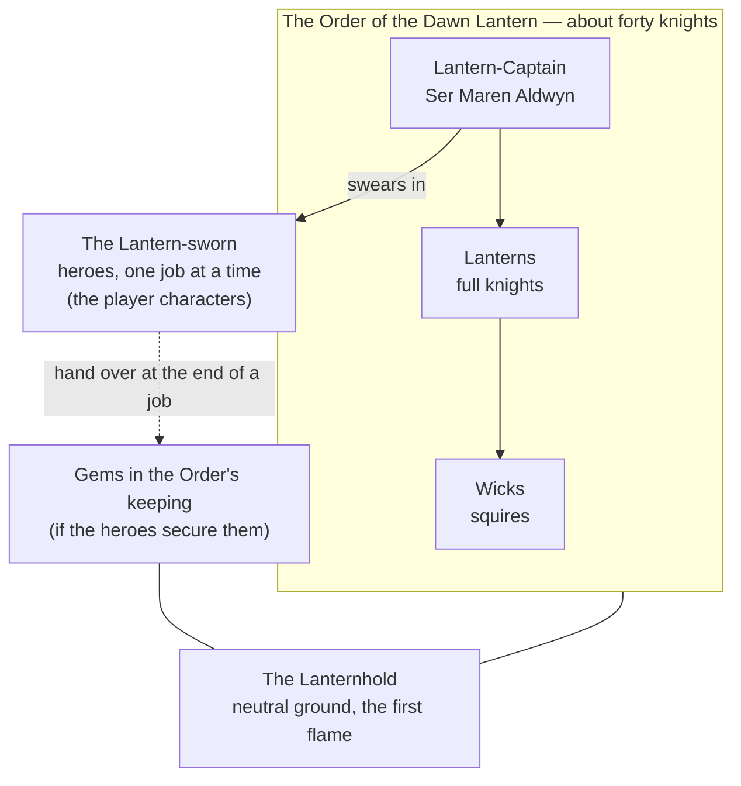

# Order of the Dawn Lantern

> **Status: done.** Built last, on top of everything else. **Not a faction like the other five:** it has no homeland, no people and no claim to the crown. It counts in the ledger only as a measure of how much it trusts the heroes.

## Who's who (quick reference)

| Term | What it is |
| --- | --- |
| **The Order** | A sworn brotherhood of about **forty knights**, recruited from every people in Calderra, loyal to the realm rather than any claimant. |
| **Lanterns** | Full knights of the Order. Each carries a lantern lit from the Order's first flame. |
| **Wicks** | Squires in training. MAX was a wick, thirty years ago. |
| **The Lantern-sworn** | Heroes sworn to the Order **for one job**. Every player character in the series. |
| **The Lantern-Captain** | Leader of the Order. Now **Ser Maren Aldwyn**. |
| **The Lanternhold** | The Order's hall: the lone castle on a hill south of Solace. The only neutral ground left in Calderra, which is why the Feast of Banners is held there. |
| **The first flame** | A flame kept burning in the Lanternhold since the Order's founding. Every Lantern's lamp is lit from it. |

**Names to remember (four):** Ser Maren Aldwyn, Ser Halvard Grey (see *Internal tension*), Ellis Wren (the quartermaster), and the Lanternhold.

**In one breath:** a handful of knights who swore to serve the realm and never rule it, who have forgotten why they were really founded, and who are about to find out, just as the heroes start handing them the pieces of a crown.

## Origins and identity

**The story they tell.** In the first emperor's wars there was a night so dark the army couldn't march. A young knight lit a lantern and walked ahead of the column all night, through the burnt west, so the soldiers behind her could find the road. At dawn the emperor offered her a lordship. She refused: "I don't want the road. I want everyone to reach the end of it." He founded the Order around her lantern, and swore it to the realm, not the throne.

**How true it is.**
<!-- secret -->
True, but only half the story. The Order's **first charter**, sealed in the Lanternhold's undercroft and unread for two hundred years, names them the **Wardens of the Seal**. The first emperor knew what his Crown was. He founded the Order to guard it, and gave them one duty above all: *if the Crown ever fails, remake it, and give it to whoever the realm chooses. Never wear it yourselves.*

Over three centuries of peace the duty was forgotten, and the Order became what it is now: knights-errant who answer calls for help. **Decided:** Ser Maren finds the charter herself during Act II, after the first gem comes into the Order's keeping. The heroes learn of it from her, when she chooses to tell them.
<!-- /secret -->

**Names.**
- They call themselves **the Order**, and each other **Lanterns**.
- Ordinary people call them **lamplighters**, fondly.
- Claimants call them "Maren's people," usually while trying to hire them.
- To the Holdfast they are "**the oath-keepers who aren't dwarves**," which is high praise.

**Defining trait.** They'd say: **we light the road; we don't claim it.** Outsiders would say: **they think they're above all of us.**

## Environment and survival

**What they have:** the Lanternhold, a good castle on a hill with no town around it and no land to farm; forty knights; a small treasury from fees; and goodwill in almost every village in Calderra.

**What they lack:** numbers. Forty knights can't hold a bridge, let alone a realm. That's why the Lantern-sworn exist.

**How they feed themselves.** Fees. The Order is paid for its help (by the Saltreach Compact, by village councils, once by the imperial treasury), and the Lanternhold buys its food at market like anyone else. It owns no land, by rule.

**Biggest threat.** **Becoming important.** As long as the Order was small and neutral, everyone tolerated it. If it starts holding gems, every claimant will want to court it, buy it, infiltrate it or burn it.

## Power and structure

**Who decides.** The **Lantern-Captain**, advised by the knights in a chapter meeting.

**How power passes: the passing of the flame.** When a Lantern-Captain dies or steps down, the knights vote, and the outgoing captain lights the new captain's lantern from their own. Maren was chosen eleven years ago, the first commoner (a Marcher shepherd's daughter) to lead the Order.

**Joining.** Anyone, from any people, may become a **wick** at fourteen. After seven years, a wick who has served well is knighted and given a lantern. **Lantern-sworn** heroes swear for a single job and are released at the end of it; some are later invited to become wicks.

**Who's at the bottom.** The wicks. They put up with the hard work because in seven years they'll be Lanterns, the only knighthood in Calderra that doesn't care who your parents were.

**Breaking the rules.**
- **Swearing to a claimant or taking land:** your lantern is put out in front of the chapter, and you leave.
- **Abandoning someone in need** while on a job: the same.
- **Lesser failings:** a year as a wick again.

## Beliefs and values

The Order has no faith of its own; its knights keep their peoples' gods.

**Sacred:**
- **The first flame,** and every lantern lit from it.
- **The road:** getting people where they need to go, safely.
- **The oath:** to the realm, never to a ruler.

**Taboo:**
- Taking a side.
- Owning land or titles.
- Letting your lantern go out on a job. Knights carry flint for the day the oil runs out.

**After death.** A Lantern's lamp is hung, unlit, in the Lanternhold's long gallery: three hundred years of dark lamps. When a new wick is knighted, they choose an old lamp to carry and learn its story. The dead knight is said to walk with them.

**Most praised virtue: service.** Help, and ask nothing.
**Tolerated vice: righteousness.** Lanterns can be insufferable about being the only people in Calderra not after something.

## Relationships

| Group | Relationship | Why |
| --- | --- | --- |
| House Ironhart | **Respect** | Brenna calls them the only lowlanders who show up when it's bad. Maren grew up in the March. |
| The Regency | **Uneasy** | Lysander can't command them, and it bothers him. The Order has never trusted a man who lies that well. |
| Stonecrown Holds | **Respect** | Oath-keepers recognise each other. |
| Saltreach Compact | **Clients** | The Reach hires the Order often, and pays on time. |
| The Ashen Pretender | **Respect, opposition** | The Heir calls them the only honest enemy. The Order refuses to call him "the Pretender" to his herald's face, which the Host has noticed. |
| The Temple | **Wary** | High Prelate Ondine thinks the Order should serve the Sun. The Order disagrees. |
| MAX | **Old friend** | See *Secrets*. |

**What they want from others:** to be called when needed, paid fairly, and left out of politics. **What others want from them:** their swords, their neutrality (until it suits someone to break it), and, once word spreads, the gems.

**What they misunderstand:**
- They think staying neutral is the same as doing no harm. Every job they take helps someone win.
- They think everyone trusts them. Everyone trusts them *not to matter*.

## Internal tension

**What they argue about.**
- **Neutral or decisive.** Is the Order's duty to stay out of the Age of Banners, or to end it?
- **Old knights and new.** Older Lanterns want the Order small and careful. Younger ones, many from the provinces, want it to recruit hundreds and actually protect people.
<!-- secret -->
- **The charter.** Once it's found: do they remake the Crown, as their founder ordered? And who chooses who gets it?
<!-- /secret -->

**Ideals vs. behaviour.** The Order says it takes no side. In practice it takes jobs from whoever pays, and the Saltreach Compact pays most.

**Who's unhappy, and what they'd do with power.**
- **Ser Halvard Grey,** the Order's oldest knight and its finest swordsman. He believes the Age of Banners will only end when someone strong ends it, and he thinks that someone is Brenna Ironhart. With power he'd put the Order, and any gems it holds, behind her.
- **The wicks,** who joined to help people and are tired of watching the Order decline jobs to stay "neutral."
- **Ellis Wren,** the Order's quartermaster. See *The mole*.

## Texture

**A typical day.** At the Lanternhold: lamps trimmed at dawn from the first flame, drill in the yard, letters read (requests for help from all over Calderra), and assignments given out at noon. On the road: walk, help, write a report.

**Celebration food:** whatever the village they're helping offers, eaten together. At the Lanternhold, on the Night of the First Lantern (the longest night of the year), a plain meal of bread, cheese and cider, eaten in the dark until the first flame is carried in at midnight.

**Knighting.** After seven years as a wick, the new knight chooses a dark lamp from the long gallery, lights it from the first flame, and keeps watch with it all night.

**Funerals.** The knight's lamp is put out by the Lantern-Captain and hung in the gallery. Every knight present says the dead knight's last job aloud.

**Sayings**
- "**Light the road; don't claim it.**"
- "Someone has to walk ahead."
- "Mind your wick." (Stay humble; also, look after the young.)

**Insults**
- "Lamp-snuffer": someone who leaves others in the dark.
- "Road-taker": someone who helps only to gain.
- "Lordling."

**Superstitions**
- A lantern that gutters for no reason means someone you're sworn to help is in danger.
- Never light a lantern from a stranger's flame.
- Leave a lamp in the window of any house you've helped. (Villages all over Calderra do this. It's how the Order finds its friends.)

## Story hooks

<!-- secret -->
**What they want right now.**
1. To keep Calderra's people alive through the Age of Banners.
2. To stay out of the claimants' fight.
3. *(Once the charter is found)* to see a new crown made, and given to whoever the realm chooses.

**What's stopping them:** forty knights; a split in the chapter; and, as soon as they hold a gem, every claimant in Calderra.

### The big secret: the Wardens of the Seal

- The Order's first charter names them **Wardens of the Seal**: guardians of the Crown, sworn to remake it if it fails and give it to whoever the realm chooses, and never to wear it themselves.
- This makes the Order the natural keeper of the gems, and gives Maren a reason to want the Forging to happen, even if she has no idea who should wear the result.
- It also makes the Order, without meaning to, **the most powerful group in Calderra**: the people who hold the pieces of the crown and say they'll give it away.

### The second secret: MAX

- MAX was a wick thirty years ago, with Maren. He left before he was knighted, when his father died and someone had to run the Broken Antler.
- When his sister Marit vanished on the road to Solace with her son, MAX wrote to Maren and asked the Order to find her. Maren searched for a year and found nothing (Lysander's exile was well hidden). She has always felt she failed him.
- Maren doesn't know Marit is the Pretender's mother. If she finds out, she will have to decide which loyalty comes first.

### The third secret: the Mind gem's cost

If the Order takes the Mind gem after the Millhaven Harvest, it falls to Maren to keep it. Its cost is sight: within weeks she is having visions, seeing through the cracks into other worlds, and something is pressing back. She hides it from the chapter. Halvard notices.

### The fourth secret: the mole

**Why are there Ashen foes everywhere the Lantern-sworn go?** Because the Order has a spy, and the Host reads every job.

- **Ellis Wren** is the Order's quartermaster: the knight who reads the letters at noon, assigns every job, and packs the supplies for each team. Quiet, kind, beloved by the wicks. He always wears gloves.
- Under the left glove is a **thorn brand**. Ellis deserted from the Thornwall at seventeen, ran south, and was taken in by the Order, which never asked. He never stopped feeling thrown away.
- Three years ago Kestrel found him with the Host's oldest question, "Who threw you away?" Since then Ellis has sent the Host a copy of every job: who's going, where, and when. That's how Host raiders keep turning up at Harrow's Ford, on the coast, at Millhaven. And once the Order holds a gem, it's how the Host will know where it is.
- **He is not cruel.** He believes the Heir is the only one who will ever make a place for people like him, and he has quietly kept the Host from killing anyone he sent.

**Running the thread:** in every one-shot, include **one Ashen presence that shouldn't be there**: scouts waiting at a crossroads only the Order knew about, a raider who knows a hero's name, a Host company arriving an hour too early. Don't explain it. Let the players get suspicious.

**Clues to scatter (one or two per one-shot):**
- A captured raider carries a copy of the job letter, in a careful clerk's hand.
- Supply packs from the Lanternhold always include a little extra lamp oil, and the Host's scouts use the same oil.
- Ellis never takes off his gloves, even at the Night of the First Lantern meal.
- At the Feast of Banners (at the Lanternhold), someone is seen leaving the letter room at midnight.
- Kestrel, if met, says something only someone inside the Order could know.

**If the heroes find him:** things get more straightforward. The ambushes stop, the gems' location is safe again, and the Host loses its eyes.
- **Exposed:** his lantern is put out before the chapter. The Order's trust in strangers is shaken; Maren is devastated.
- **Turned:** if the heroes keep his secret and Maren agrees, Ellis keeps writing to Kestrel, but now the letters say what the Order wants the Host to believe.
- **Asked why:** "Who threw you away?" is the question that made him. A hero who answers it for him (the Order didn't; neither did they) might bring him back.

### What would change or destroy them

- **Change:** the charter. Knights-errant become Wardens of the Seal, and the Order stops pretending it doesn't matter.
- **Destroy:** a spy who delivers the gems to a claimant; Halvard taking the Order to Brenna; or the Order caught helping one side, which would end everyone's trust in it at once.

## Hooks for one-shots

- **Every one-shot:** Ser Maren, or a Lantern she sends, is the default quest-giver. She swears in the Lantern-sworn and releases them at the end.
- **The Millhaven Harvest:** Maren comes herself, because MAX asked. If the heroes find the Mind gem, she takes it into the Order's keeping.
- **The Feast of Banners:** held at the Lanternhold, the only neutral ground left. The Order is the host, responsible for everyone's safety, and someone is poisoned under its roof.
- **The Regent's Vault:** if the heroes take the Heart gem, it comes to the Lanternhold, and Lysander knows exactly where to look.
- **The Forging:** the Order escorts the gems and the smith. Halvard may try to hand the crown to Brenna on the way down.
- **The Council of Banners:** the Order brings the crown to the table and, if the charter is found, must give it away.

## Private hooks for Lantern PCs (hand out in person)

For a player who plays a full knight or wick of the Order, not just a Lantern-sworn hero.

1. **The undercroft.** As a wick you were sent to clean the Lanternhold's undercroft, and found a sealed iron case with the first emperor's seal on it. You were told to put it back and forget it.
2. **Halvard's letter.** You carried a sealed letter from Ser Halvard to House Ironhart. He told you it was about horses.
3. **The captain at night.** You've seen Ser Maren in the chapel after midnight, staring into her lantern and talking to it, more than once.
4. **The lamp you carry.** The dark lamp you chose at your knighting belonged to the knight who walked ahead of the first emperor's army. Its glass is etched with words in an old script you can't read.

## For the Ashen Pretender

**The weakness he'd exploit: anyone can be Lantern-sworn.** The Order swears in strangers for one job at a time and trusts them. Kestrel only has to plant one of the Host's people among the heroes, or among the wicks, to learn where the gems are kept. And if the Order holds gems, he needs only to tell every claimant the "neutral" knights are hoarding the crown, and watch them turn on it.
<!-- /secret -->
