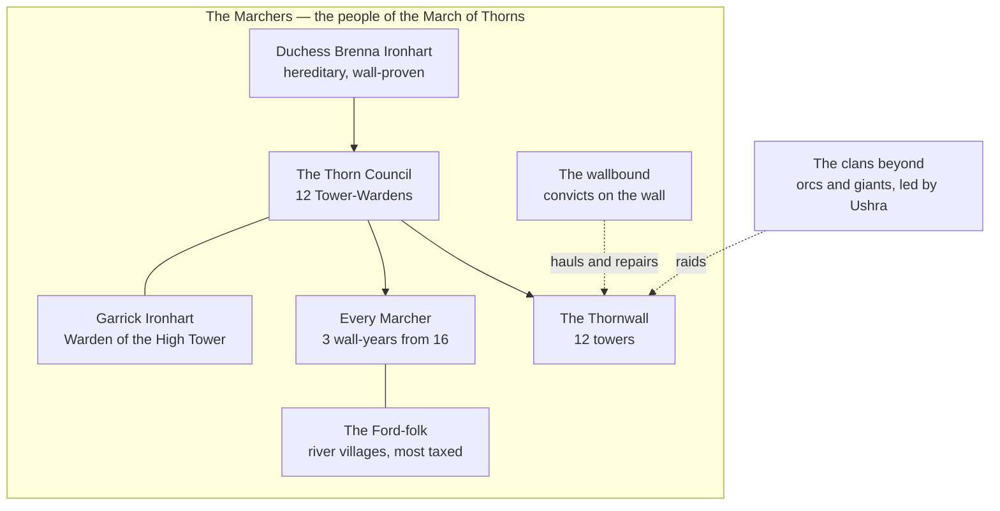

# House Ironhart

> **Status: done.** Built second: the Ironharts arrived with the empire's first armies, after the dwarves and before everyone else.

## Who's who (quick reference)

| Term | What it is |
| --- | --- |
| **Marchers** | The people of the March of Thorns: soldiers, shepherds, farmers and their families. What they call themselves. |
| **House Ironhart** | The ruling family, dukes of the March for three hundred years. |
| **The Thornwall** | The great wall along the north edge of the March, with **twelve towers**. Built with dwarven stone. |
| **The Duke or Duchess** | Hereditary ruler; the eldest child inherits, but only after proving themselves on the wall. Now **Duchess Brenna Ironhart**. |
| **The Tower-Wardens** | Twelve knights, one per tower. Together they are the **Thorn Council**, which advises the duchess. |
| **Wall-years** | Three years every Marcher, man or woman, serves on the wall from age sixteen. |
| **The wallbound** | Convicts sentenced to repair and haul for the wall. The bottom of Marcher society. |
| **The Ford-folk** | The river villages in the south of the March, like Harrow's Ford. They pay most of the taxes and take most of the raids. |
| **The clans beyond** | The orc and giant clans north of the wall. |

**Names to remember (four):** Brenna Ironhart (the duchess), Garrick Ironhart (her brother, Warden of the High Tower), **Ushra** (the orc war-mother leading the clans), and the Thornwall. Everything else can stay unnamed until a session needs it.

**In one breath:** a proud, hard, genuinely heroic people who have spent three hundred years guarding a wall, built on stone they never paid for and on land that was never theirs to take, and who are about to run out of money to hold it.

## Origins and identity

**The story they tell.** Three hundred years ago, when the first emperor's armies marched north, the giants came down through the Thorn Gap to stop them. A knight named **Corwen Ironhart** held the gap alone for three days and three nights until the legion arrived. The emperor gave him the whole March and one order: *hold it*. Every Ironhart since has.

**How true it is.**
<!-- secret -->
Corwen was real, and brave. But the giants weren't invading. The land north of today's wall, and much of the March itself, was the homeland of the orc clans and their giant allies. Corwen didn't just hold a gap. After the battle he signed **the Thorn Pact** with the clans: the empire would stop at the river, and the clans would keep the high pastures forever.

Two years later, with a legion behind him, Corwen broke the pact, drove the clans north, and built the first stretch of the Thornwall to keep them out. The clans have raided ever since. Marchers believe the raids are mindless savagery. To the clans, they are three hundred years of trying to go home.

The original Thorn Pact, with Corwen's broken seal, hangs in the Ironhart chapel behind a curtain. Each new duke or duchess reads it alone on the night of their succession. **Brenna knows.**
<!-- /secret -->

**Names.**
- They call themselves **Marchers**, and their homeland simply **the March**.
- Lowlanders call them **wallborn**, half admiring and half pitying.
- The dwarves call them **"the stone-debtors"**, for the Thornwall that was never fully paid for.
- The clans beyond call them a word that translates roughly as **"the fence-builders."**

**Defining trait.** They'd say: **we hold.** Outsiders would say: **they never let go of anything.**

## Environment and survival

**What the March gives:** wide cold grassland, good horses, tough sheep, wool, rye and barley, pine forests near the wall, and the river at Harrow's Ford, full of fish.

**What it withholds:** a long summer, rich soil, iron (bought from the dwarves), and above all **money**. The wall eats everything. For three hundred years the imperial treasury paid for the Thornwall's garrison. That money stopped the day the emperor died.

**How they feed themselves.** Rye bread, mutton, river fish and whatever Greenhollow sells cheap in autumn. The Ford-folk farm; the north grazes sheep and horses.

**Who does the hard labour.** Everyone, for a while: **wall-years** are universal, noble and peasant alike. The worst work (hauling stone, rebuilding after raids, clearing the dead) falls to **the wallbound**.

**Biggest threat.** On paper, the clans beyond. In truth, **poverty**. The legions are gone, the treasury is gone, and a wall with twelve towers takes more soldiers and coin than the March has.
<!-- secret -->
Three of the twelve towers are already **hollow towers**: unmanned, their beacons kept lit by two old wardens on a circuit, with **straw wardens** (dummies in helmets) on the walls to fool scouts. Only Brenna, Garrick and the Thorn Council know.
<!-- /secret -->

## Power and structure

**Who decides.** The Duke or Duchess, advised by the **Thorn Council** of twelve Tower-Wardens.

**How they got that right.** Corwen's line was granted the March by the first emperor. The family's real claim, though, is the wall itself: Marchers follow Ironharts because Ironharts stand on the wall with them.

**How power passes.** The eldest child inherits, man or woman, but only after being **wall-proven**: serving their wall-years and holding a tower through a full winter. An heir who fails is passed over for the next sibling. Brenna held the High Tower through the worst winter in living memory. Garrick holds it now.

**Who's at the bottom.**
- **The wallbound:** convicts sentenced to years of wall labour. They put up with it because a wallbound who survives their sentence is free and pardoned, and some of the best wardens were once wallbound.
- **The Ford-folk:** the southern river villages. They pay most of the taxes, get raided first, and feel ignored by a duchess whose eyes are always on the north. They are not putting up with it much longer.

**Breaking the rules.**
- **Desertion** from the wall: a thorn branded on the back of the hand, and a sentence as wallbound.
- **Letting a beacon go dark** through neglect: the same.
- **Treason:** put out beyond the wall, unarmed, at dusk.

## Beliefs and values

**Sacred:**
- **The Thornwall.** Not as a building, as a promise.
- **The beacon chain.** A line of signal fires along the wall's twelve towers. In three hundred years it has never all gone dark at once.
- **The post.** Wherever you are told to stand, you stand.

**Taboo:**
- Leaving a post. Letting a fire go out.
- Crossing north of the wall without leave.
- Showing your back to the north while you sleep.

**After death: the long watch.** The dead don't go anywhere. They stand the long watch on the wall forever. When a Marcher dies, they are burned on a beacon fire and their ashes are **mortared into the next repair of the wall**, so the Thornwall is literally built of its own dead. On winter nights, when a beacon flame burns blue, a Marcher will tell you the dead are walking past.

**Most praised virtue: steadfastness.** You stay. You hold. You don't complain about it.
**Tolerated vice: no mercy for the north.** Nothing beyond the wall is owed kindness. A Marcher who spares a clan raider is a fool at best and a traitor at worst. Marchers don't consider this a flaw.

## Relationships

| Group | Relationship | Why |
| --- | --- | --- |
| Stonecrown Holds | **Rival, grudging respect** | The Thornwall is built of dwarven stone the Ironharts never fully paid for, and both claim the high pass between the Spine and the March. Marchers think the dwarves are greedy hoarders. Both are proud. |
| The Regency | **Bitter** | In the emperor's last sick years, wall pay arrived late and short. Brenna blames Lysander personally. |
| Greenhollow | **Protective, unthanked** | Marchers feel they shield the farmers who never say thank you. (Greenhollow's grain tax has helped pay for the wall for a century; most farmers don't know.) |
| Saltreach Compact | **Distant** | Merchants. Useful for selling wool and buying arrows. Not trusted with anything that matters. |
| The clans beyond | **Enemies for three hundred years** | See *Origins*. |
| Order of the Dawn Lantern | **Respect** | The only lowlanders who show up when it's bad. |

**What they want from others:** coin, soldiers and iron to hold the wall, and a crown for Brenna so the treasury pays for it again. **What others want from them:** the wall held (everyone), the high pass (the dwarves), and Brenna's soldiers on their side when the Age of Banners turns to war.

**What they misunderstand:**
- They think the dwarves are hoarding out of greed. The Holds are frightened and shrinking.
- They think Greenhollow is ungrateful. Greenhollow has been paying for the wall all along.
<!-- secret -->
- They think the clans are mindless raiders. The clans are organised, follow old clan law, and are trying to go home. Only Brenna knows why.
<!-- /secret -->

## Internal tension

**What they argue about.**
- **The wall or the crown.** Brenna is going south to claim the throne. The old wardens say a duchess's place is on the wall, and that leaving it half-manned to chase a crown is exactly how walls fall.
- **The south vs. the north.** The Ford-folk want lower taxes and real protection. The north says the wall *is* their protection.
- **Wall-years.** The young are tired of losing three years each to a wall that might not survive the decade.

**Ideals vs. behaviour.** They are the people who keep their posts and their word to the death.
<!-- secret -->
Their house was founded on a broken word, and every Ironhart knows it. Brenna's answer is the only one her family has ever given: hold the wall anyway, because the people behind it now are innocent.
<!-- /secret -->

**Who's unhappy, and what they'd do with power.**
- **Garrick Ironhart**, Brenna's younger brother and Warden of the High Tower. Loyal, cautious and furious that she's leaving the wall half-manned to chase a crown. With power he'd pull the March out of the throne race entirely and do *whatever it takes* to keep the wall standing.
<!-- secret -->
That includes listening to the Ashen Pretender's herald, who has offered peace on the wall in exchange for the March staying out of the war. Garrick hasn't answered. He hasn't refused either. He keeps the herald's letters (**Garrick's letters**) in his tower.
<!-- /secret -->
- **The Ford-folk reeves**, the elected heads of the river villages, who would trade the March's claim to the throne for a fair tax and a garrison at every bridge.

## Texture

**A typical day.** A horn at dawn from the nearest tower. Drill in the yard for anyone on wall-years; fields, flocks or forge for everyone else. Evenings around the hearth with rye beer, wool-work and stories about who held which tower in which winter.

**Celebration food:** black rye bread, mutton and barley stew, blood sausage, river trout smoked over pine, honey cakes at midwinter, and **frostberry wine**, sour and strong, made from the berries that grow along the wall's foot.

**Weddings.** The couple stands a night watch together on the wall, side by side, until dawn. At sunrise they light a beacon together, and everyone in sight of it cheers.

**Funerals.** The body burns on a beacon fire. The dead's shield is hung inside the nearest tower. The ashes are kept until the next repair, then mortared into the stone. Mourners say: *"Stand easy. We have the watch."*

**Sayings**
- "**Light the next fire.**" (Do your part and pass it on.)
- "North isn't a direction. It's a warning."
- "The wall doesn't care how you feel."

**Insults**
- "**Southsoft**": anyone who's never stood a winter watch.
- "Deserter's hand" (a nod to the thorn brand).
- "Fair-weather."

**Superstitions**
- Never sleep with your back to the north.
- A blue beacon flame means the dead are walking the watch. Say their name if you know it.
- Throw a stone over the wall before a battle, for luck. (Clan children throw them back.)

## Story hooks

<!-- secret -->
**What they want right now.**
1. Money and soldiers to man all twelve towers before winter.
2. The throne for Brenna, so the treasury pays for the wall again.
3. To hold Harrow's Ford, the last bridge, without pulling more soldiers off the wall.

**What's stopping them:** the empty treasury; the dwarven debt (the Holds won't sell more stone or iron until it's paid); the Regency stalling; and Brenna's own refusal to ask anyone for help.

### The big secret: the Thorn Pact

- Corwen Ironhart signed the **Thorn Pact** with the clans three hundred years ago, then broke it. The March is largely stolen land. The clans aren't raiding; they're trying to go home.
- The original document hangs in the Ironhart chapel. Every heir reads it alone. Brenna knows, and holds the wall anyway, for the people living behind it now.
- **War-mother Ushra**, who leads the clans, carries the clans' copy of the pact. Her warband's champion at Harrow's Ford is her son.

### The second secret: the hollow towers

Three of the twelve towers are empty, kept lit by two old wardens on a circuit, with straw dummies on the walls. A single scout who climbs one would learn the Thornwall is a third weaker than anyone believes.

### What would change or destroy them

- **Change:** honouring the Thorn Pact. Peace with the clans would end the wall's reason to exist, and with it, the Ironharts' reason to rule.
- **Destroy:** a winter breach through a hollow tower; Garrick siding with the Pretender; or the Thorn Pact made public at the Council of Banners, where every claimant would ask why Brenna should rule an empire when her house can't keep its own word.

## Hooks for one-shots

- **Hold the Bridge at Harrow's Ford:** the warband's champion is **Ushra's son**. If the heroes spare him, he tells them about the Thorn Pact, and Ushra becomes a possible ally against the Pretender. *(Maybe. Decide when building the adventure.)*
- **The Feast of Banners:** Brenna and Hilde Stonecrown meet privately. Hilde offers to forgive the dwarven stone debt in return for the high pass. Brenna has to decide whether to give up land her people bled for.
- **The Pretender's Mask:** Garrick's letters are in the Pretender's camp too. Heroes who find them learn the March could fall without a single battle.
- **The Council of Banners:** the Thorn Pact is Ironhart's secret alone. **Lysander does not know.** It can only come out if the heroes (or Ushra) bring it.

## Private hooks for Marcher PCs (hand out in person)

1. **The hollow tower.** You served your wall-years at one of the three empty towers. You were sworn never to say it was empty. You haven't. Yet.
2. **Ushra's mark.** On a raid when you were young, a clan warrior had you on the ground and let you go. You still have the bone token she pressed into your hand. You've never shown it to anyone.
3. **The chapel curtain.** You were a servant in the Ironhart keep. One night you saw Brenna come out of the chapel weeping, and she made you swear to forget it.
4. **Garrick's courier.** You carried a sealed letter from the High Tower to a stranger in a grey mask at a crossroads. Garrick paid you double and told you to forget his face.

## For the Ashen Pretender

**The weakness he'd exploit: the Thorn Pact.** He doesn't need to break the Thornwall; he needs to make the clans an offer. He promises Ushra the high pastures back (Corwen's broken promise kept at last), and three hundred years of grievance becomes his army. And through Garrick he offers the March peace for staying out of the war, which pulls Brenna's soldiers off the board without a fight.
<!-- /secret -->
