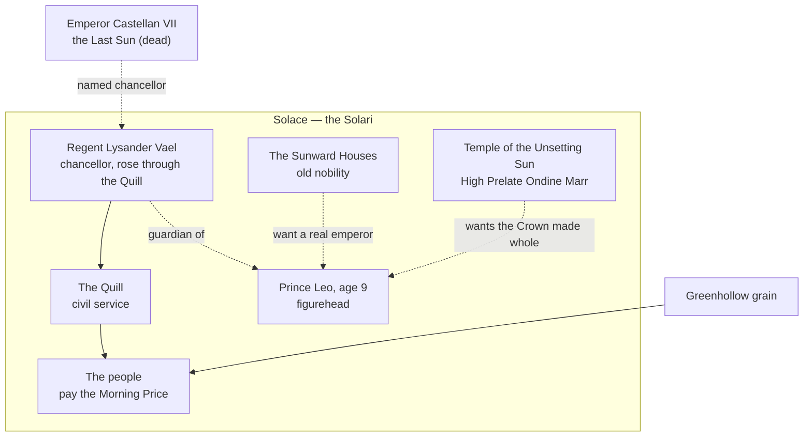

# The Regency

> **Status: done.** Built third: the imperial court came after the dwarves and the march-lords, and grew up around them.

## Who's who (quick reference)

| Term | What it is |
| --- | --- |
| **The Solari** | The people of Solace, the capital. What they call themselves. Heartland farmers call themselves Heartlanders. |
| **The Regency** | The government in Solace since the emperor died: Lysander and the imperial offices he controls. |
| **The Quill** | The imperial civil service: clerks, tax-assessors, archivists. Promotion by exam, not birth. Lysander rose through it. |
| **The Sunward Houses** | The old noble families of Solace. Rich, proud, and with no army to speak of. |
| **The Temple of the Unsetting Sun** | The imperial faith. Teaches that the emperor is the Sun on earth. Led by the **High Prelate**. |
| **The Granaries** | The imperial granaries, mills and licensed bakeries. The Regency owns the whole chain from Greenhollow's fields to the baker's oven, and sets the price of bread. |
| **The Morning Price** | The price of a loaf, read out on the palace steps at dawn. The Regency's main tool of power. |
| **Prince Leo** | A nine-year-old great-nephew of the late emperor. The Regency's figurehead. |

**Names to remember (five):** Regent Lysander Vael, Prince Leo (the child), Lady Corisande (his mother), High Prelate Ondine Marr (the temple), and Emperor Castellan VII, the Last Sun (dead).

**In one breath:** a beautiful, frightened capital that still believes in an empire, run by a decent man who has spent a decade lying to keep it fed, and whose greatest lie is that the empire only ended six months ago.

## Origins and identity

**The story they tell.** Before the empire there were only warring kingdoms. Then the Sun came down to earth as the first emperor and lit the world. Solace was built where the light first touched the ground, and for three hundred years every emperor was the Sun reborn. Where the empire went, came roads, law, coin and peace.

**How true it is.** Mostly propaganda, partly true. The first emperor was a warlord from the bay who won with the best roads and the best clerks in the land. The empire did bring roads, law and peace. It also took Greenhollow's grain, the dwarves' taxes and the March's sons, and called it light.

**Names.**
- They call themselves **Solari**, "the sun's people."
- Provincials call them **"the Gilt"**, or "bread-masters," because Solace decides what everyone else pays for bread.
- Imperial documents call everyone outside Solace "the provinces", which everyone outside Solace hates.

**Defining trait.** They'd say: **we are civilisation.** Outsiders would say: **they think the world owes them breakfast.**

## Environment and survival

**What the Heartlands give:** a great harbour on the southern bay, every road in Calderra meeting at one city, marble quarries, vineyards and olives, scholars, banks and the imperial mint.

**What they withhold:** enough food. Solace has more people than the Heartlands can feed. For three hundred years the empire has bought, taxed and stored Greenhollow's grain in the **imperial granaries**, milled it in imperial mills, and sold it through bakeries that hold a Granary licence. No one in the Heartlands bakes for sale without one.

**Who does the hard labour.** Heartland tenant farmers, dockworkers on the bay, and the city's servants. The Solari themselves are clerks, priests, artisans, traders and idle nobles.

**Biggest threat.** Hunger, and losing control of the bread. The Granaries are how the Regency rules: towns that stay loyal get a low price, towns that don't get a high one, and rebels get none. If grain stops arriving, or someone else starts selling bread cheaper, the Regency's power goes with it. Every regent before Lysander knew the rule: *whoever sets the price of bread rules Solace.*

## Power and structure

**Who decides.** Right now, **Regent Lysander Vael**. By imperial law, the chancellor governs as regent until the **Council of Banners** names a new ruler, one year after an emperor's death.

**How he got that right.** Lysander was born a dockworker's son and rose through the **Quill** by exam, the first commoner ever to become chancellor. The Sunward Houses never forgave him.

**How power passes.** Officially, by blood: the Sun passes father to child. But the Last Sun died without a legitimate heir, so the Council of Banners must choose. Lysander wants the Council to become **permanent**, a council ruling in Leo's name for good. The Sunward Houses want Leo crowned. The Temple wants the Crown made whole first.

**Who's at the bottom.** The city's poor and the Heartland tenant farmers. They put up with it because the Regency keeps the Morning Price low for them, low enough to live on. Raise it a copper and the lower city starts to murmur; raise it a silver and it riots.

**Breaking the rules.**
- Crimes against citizens: fines and the stocks, judged by Quill magistrates. The empire's law is fair, written and slow.
- Treason: exile from Solace, which for a Solari is a kind of death.
- **Smashing a sun-mark** (the sun symbol on every public building): flogging. People have started doing it at night.

## Beliefs and values

**Sacred:**
- **The Sun.** The emperor was the Sun on earth; the Temple of the Unsetting Sun keeps an eternal flame in the palace dome.
- **Law and records.** If it isn't written down, it didn't happen.
- **Bread.** Wasting it is shameful. Hoarding it is a crime: only the Granaries may store grain.

**Taboo:**
- Saying the emperor is **dead**. The Solari say "**the Sun rests**."
- Letting the temple flame go out. It never has.
- Burning documents.

**After death.** The faithful rise into the sun and become part of its light; emperors become the sun itself. That's why the Crown vanishing on the night the Last Sun died terrifies the faithful: the Sun took his crown with him. The High Prelate preaches there is no new dawn until a new crown is made, on a blood heir's head.

**Most praised virtue: order.** Civilisation is keeping things running: roads, laws, bread.
**Tolerated vice: the comfortable lie.** Solari think a convenient untruth that keeps the peace is good manners. Lysander is very, very polite.

## Relationships

| Group | Relationship | Why |
| --- | --- | --- |
| Greenhollow | **Dependent and taking it for granted** | Their grain feeds Solace. The Solari barely know where Greenhollow is. |
| House Ironhart | **Mutual blame** | Wall pay ran late and short in the emperor's last years. Brenna blames Lysander. Lysander thinks the March costs more than it's worth. |
| Stonecrown Holds | **Leverage** | The dwarves owe imperial taxes and claim independence. <!-- secret -->Lysander knows about the dragon fraud.<!-- /secret --> |
| Saltreach Compact | **Necessary rivals** | The Compact's ships bring everything Solace imports. Their independence is a direct loss of tax and pride. |
| Prince-Merchants of Vareth | **Distrust** | They'd buy the throne if it were for sale, and the Regency suspects it might be. |
| Order of the Dawn Lantern | **Uneasy** | The Order swore to the realm, not the Regency. Lysander can't command them, and it bothers him. |

**What they want from others:** grain (from Greenhollow), soldiers (from Ironhart), coin (from Saltreach and the dwarves), and everyone's agreement that the empire still exists. **What others want from them:** the throne's legitimacy, the mint, the roads and the Crown gems.

**What they misunderstand:**
- They think the provinces love the empire. The provinces paid for it.
- They think the Granaries keep Calderra fed. Greenhollow thinks the empire buys its grain cheap and sells it back dear.
- They think the Age of Banners is a pause. It's the end.

## Internal tension

**What they argue about.**
- **A council or a crown.** Lysander and much of the Quill want a permanent council. The Sunward Houses want Leo crowned emperor. The Temple wants the Crown made whole first, which means finding the gems.
- **Bread or walls.** The treasury can't afford both a low Morning Price and the March's wall pay. For years, it has quietly chosen bread.
- **Commoners and nobles.** The Quill is the one place a nobody can rise. The Sunward Houses want it back under their control.

**Ideals vs. behaviour.** They are the people of law, records and order.
<!-- secret -->
For the last eight years of his reign, the Last Sun was **sun-sick**: lost to a wasting madness, he didn't recognise his own servants. Lysander hid it. He **ruled in his name**, forged the imperial signature on every decree under the emperor's privy seal, the **Quiet Seal**, and told the provinces the emperor was simply "resting from public life." Calderra's last eight years of imperial law were written by a dockworker's son. The court calls them nothing; Lysander, privately, calls them **the eight dark years**.
<!-- /secret -->

**Who's unhappy, and what they'd do with power.**
- **High Prelate Ondine Marr.** A true believer who thinks the Sun will only rise again when the Crown is whole and on a blood heir's head. With power she'd crown Leo at once and send the Temple's agents after every gem, no matter whose. She suspects Lysander is hiding something about the gems.
- **Lady Corisande**, Prince Leo's mother, of the Sunward Houses. Wants her son crowned and Lysander gone, and is courting House Ironhart's soldiers to make it happen. **Decided:** she hires the poisoner at the Feast of Banners.
- **The Solace poor.** If the Morning Price climbs much further, they'll follow anyone who promises cheaper bread.
- **Unlicensed bakers.** Small ovens in the lower city baking without a Granary licence, on grain smuggled in by Saltreach ships. The Quill fines them; the people love them.

## Texture

**A typical day.** Morning bells from the temple dome; a crier on every corner repeats the **Morning Price**, and the whole city does the same sum before breakfast. Work at the Quill offices, the docks, the markets or a noble house. Afternoons at the public baths, where all the real politics happens. Evenings at the theatre or a wine shop. Everyone wears a small mask at public events: an old court custom that now hides who's meeting whom.

**Celebration food:** white bread (a luxury: everyday Granary bread is brown), honeyed figs, olives, roast fish from the bay, saffron rice, spiced wine, and **sun-cakes**, little gold-glazed cakes stamped with the sun.

**Weddings.** The couple is married at dawn at the temple steps, and both sign the city register; a wedding isn't legal until it's written down. Guests throw grain, which provincials find appalling.

**Funerals.** The body is carried to the hilltop pyres at sunset, burned so the soul rises with the smoke toward the sun, and the name is entered in the temple's Book of Light.

**Sayings**
- "**The Sun rests.**" (Said of anything that's ended and shouldn't be talked about.)
- "If it's not in ink, it's in the wind."
- "Bread at dawn, peace at dusk."

**Insults**
- "**Provincial.**" (Devastating, in Solace.)
- "Torch-and-pitchfork" (anyone who solves problems loudly).
- "Unwritten" (someone who doesn't matter).

**Superstitions**
- Never let your shadow fall on a sun-mark.
- If the temple flame flickers, someone important will die before the week is out.
- Never cut bread with a blade on a feast day; tear it. A cut loaf means a cut price, and cheap bread is a bad omen.

## Story hooks

<!-- secret -->
**What they want right now.**
1. To reach the Council of Banners with the empire still whole and Lysander still in charge.
2. To keep the Granaries full and the Morning Price steady through a year of war.
3. To keep the Heart gem hidden until the Council, then use it as the deciding piece.

**What's stopping them:** the treasury is empty; Greenhollow's grain tax isn't arriving reliably; the Temple and the Sunward Houses are working against Lysander; and every claimant has spies in Solace.

### The big secret: the eight dark years

- The Last Sun was **sun-sick** for the last eight years of his reign. Lysander hid it, ruled in his name and forged his signature with the Quiet Seal.
- Every imperial decree of those years, including the wall-pay cuts that crippled the March, was Lysander's own decision.
- If it came out, the Regency's legitimacy would collapse overnight: eight years of law would be void, and no one would trust Lysander to run a council.

### Why the wall pay ran short

Lysander chose bread over walls. With the grain tax falling and the treasury thin, he held the Morning Price down and cut the March's pay. And he **kept paying** the dragon tribute to the dwarves after he learned it was a fraud, because stopping would have told the Holds he knew. So part of what starved the Thornwall went straight into the Stonecrown vaults, to protect his leverage. And another part, booked as pay for a frontier garrison, went west to buy the silence of the emperor's exiled son.

And when even that wasn't enough, he borrowed. The treasury sold **Sun Bonds** to the Old Houses of Saltreach to keep the Granaries full. The empire now owes them more than it could repay in a century (see `saltreach.md`).

### The Heart gem

On the night the Last Sun died, Lysander was alone at the bedside. The emperor made him promise to keep the empire whole. Then the Crown turned to light and was gone, and one gem fell into Lysander's hands. He hid it in the vault beneath the palace, and had a replica crown made for the cushion in the throne room so the court would have something to bow to.

The Heart holds its bearer to their deepest promise. Lysander's is the one he made that night. It is why he cannot let the empire go, and why every lie he tells is in its service. See `world/sunfire-crown.md`.

**The sun-sickness** was the old Crown failing: forty years on one brow, with the cracks pressing harder, broke the emperor's mind. Lysander doesn't know that. He thinks he hid an illness.

### The heir question

- The Ashen Pretender claims to be the emperor's secret son. He is, and **Lysander knows**, because Lysander exiled him.
- **When:** in the third of the eight dark years. A woman from the provinces came to court with a boy of about sixteen and a ring the Last Sun had given her, asking for the boy to be recognised.
- **Why Lysander did it:** an audience would have shown the court the emperor was sun-sick. And in a rare lucid hour the Last Sun *did* know them, wept, and wrote a few lines acknowledging the boy as his son.
- **What Lysander did:** he signed the **exile order** under the Quiet Seal and had mother and son taken to the far west, to the ruined frontier. The Solari never burn documents, so he kept the emperor's acknowledgement too. **It's in the vault beneath the palace, beside the Heart gem.**
- **The hush money.** Exile alone wasn't enough; a desperate woman with a ring and a story could still talk. So Lysander paid them to stay silent: a yearly stipend in imperial gold, sent west under the Quiet Seal and hidden in the treasury books as upkeep for a **frontier garrison** that doesn't exist. Officially, it was wall pay.
- The mother spent almost none of it. For five years she saved every coin.
- When the Last Sun died, the stipend stopped. Within a month her son had used the hoard to hire his first mercenaries and buy the loyalty of the first monster clans. **The Regency's own gold paid for the start of the Pretender's war.**
- So Lysander knows the Pretender's claim is real, and that his own forged order created the war's greatest enemy. The boy would be about twenty-one now.
- **The courier.** The hush money went west every winter with a single Quill courier. Five years ago the courier vanished on the road, and Lysander believes they died. They didn't: the courier is **Kestrel**, the Pretender's herald, and knows every secret of the Regency. See `ashen-pretender.md`.

### What would change or destroy them

- **Change:** a real council of all the factions, not just Solace. Lysander might even accept it, if he could stop lying long enough to propose it.
- **Destroy:** the eight dark years made public; the Granaries running empty, or someone else selling bread cheaper; or the Heart gem stolen before the Council.

## Hooks for one-shots

- **The Regent's Vault:** the heroes come for the Heart gem, and also find the vault's archive: the emperor's sickbed records, the Quiet Seal, Lysander's ledger of what he paid the dwarves and the exiles, and **the Last Sun's acknowledgement of his son**. The real choice becomes *what to take*.
- **The Feast of Banners:** Lady Corisande wants Lysander dead before the Council. The poison was meant for him, and hit someone else.
- **The Millhaven Harvest:** one of the two armies wanting Millhaven's grain could be the Regency's, desperate to refill the Granaries.
- **The Council of Banners:** the High Prelate demands the gems be laid on the table. Lysander has to decide whether to reveal his.

## Private hooks for Solari PCs (hand out in person)

1. **The copyist.** You worked in the Quill copying imperial decrees. Every one from the last eight years was signed in a hand that never shook, even when the court said the emperor was too ill to hold a cup.
2. **The night servant.** You carried trays to the emperor's chambers in his last years. He called you by your grandmother's name, and once asked you what year it was.
3. **The Granary count.** You counted sacks in an imperial granary. The tally sent to the palace says the granaries are half full. You've seen the floors. They're nearer a quarter.
4. **The Prelate's errand.** High Prelate Ondine paid you to find out whether there's anything hidden beneath the palace. You haven't told her what you found: a door with no keyhole, guarded day and night.

## For the Ashen Pretender

**The weakness he'd exploit: legitimacy and bread.** He is everything Lysander isn't: the Last Sun's own blood. He doesn't need to storm Solace; he needs the city to open its gates. He'll expose the eight dark years (eight years of law signed by a forger), then cut the Greenhollow grain. When the Morning Price doubles, he'll be at the gates selling bread cheap, with a true heir's face.
<!-- /secret -->
