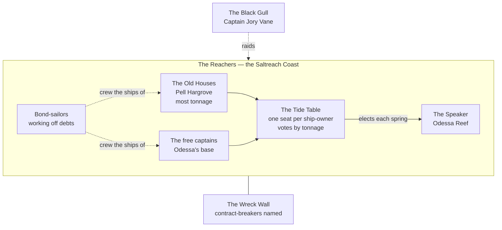

# Saltreach Compact

> **Status: done.** Built fourth: the newest power in Calderra, merchants who grew rich in the empire's last century.

## Who's who (quick reference)

| Term | What it is |
| --- | --- |
| **Reachers** | The people of the Saltreach Coast: sailors, fishers, dockhands, shipwrights, traders. What they call themselves. |
| **The Saltreach Compact** | The merchant republic declared the week the emperor died. Also the signed agreement that created it. |
| **The Tide Table** | The governing council. Every captain who owns a ship gets a seat; votes are weighted by tonnage. |
| **The Speaker** | Chairs the Tide Table, elected each spring. Now **Guildmistress Odessa Reef**. |
| **The Old Houses** | The great trading families who ran imperial shipping for a century. The richest votes at the Table. Led by **Magnate Pell Hargrove**. |
| **The free captains** | Small ship-owners, ex-smugglers and fishers. Odessa's base. |
| **Bond-sailors** | Sailors working off a debt (passage, a lost cargo, a family loan) under a bond held by a ship-owner. The bottom of Reacher society. |
| **The Wreck Wall** | A harbour wall in every port where the names of people who broke a contract are painted. No Reacher will trade with a name on it. |
| **The Black Gull** | The imperial navy's last warship, now a pirate. Captain **Jory Vane**. |

**Names to remember (four):** Odessa Reef (the Speaker), Pell Hargrove (the Old Houses), Jory Vane (the Black Gull), and the Tide Table.

**In one breath:** the freest people in Calderra, who keep honest books and pay their debts, run a republic where votes are bought by the ton, and whose richest families are secretly owed so much by the old empire that only its restoration can repay them.

## Origins and identity

**The story they tell.** The coast was nothing but salt marsh and fishing huts when the first captains came. They dug the harbours with their own hands, built ships from the eastern pines and traded with anyone who'd trade back. Everything the Reach has, it earned. The empire only ever showed up to collect taxes.

**How true it is.** Half true. The fishing villages were real, and the captains were bold. But the Reach got rich a hundred years ago, when the empire granted the **Saltreach Charter**: a monopoly on carrying imperial goods, tax and grain by sea. The Old Houses are the families who held that charter. Their fortunes were built on imperial contracts, not free trade. When the emperor died, the Compact declared the charter, and the empire, finished. The Old Houses signed. Their reasons were not the same as Odessa's.

**Names.**
- They call themselves **Reachers**, and their homeland **the Reach**.
- Lowlanders call them **coin-gulls**: loud, everywhere, and after your purse.
- The Solari call them "the Compact" with a sniff, as if it were a disease.
- Their favourite name for themselves, in a toast: **"free hulls."**

**Defining trait.** They'd say: **we pay our way.** Outsiders would say: **everything has a price, to them.**

## Environment and survival

**What the Reach gives:** deep harbours; the eastern pine forests for ships; salt pans along the marsh, and salt fish, which feed half of Calderra's armies through winter; and the sea itself, the fastest road in the world.

**What it withholds:** farmland. The coast is salt marsh, pine and rock. Grain comes from Greenhollow and the Delta, bought cheap and carried by sea.

**How they feed themselves:** fish, salt pork, shellfish, and bought grain. Reachers eat well because they can always buy.

**Who does the hard labour:** **bond-sailors** crew the ships and work the salt pans. A bond is usually five years. It's honest work, and most bond-sailors finish. Some find their bonds sold and resold, and never quite do.

**Biggest threat.**
- **Outside:** the navy turned pirate. The imperial fleet went unpaid when the emperor died, and some ships, led by the Black Gull, now take what they want.
- **Inside:** debt. The whole Reach runs on credit. If the war ruins enough of the people who owe it money, the Reach goes down with them.

## Power and structure

**Who decides.** **The Tide Table**: every captain who owns a ship has a seat, and votes are weighted by **tonnage**. A fishing boat is one vote; a great merchantman is forty.

**How they got that right.** By signing the Compact the week the emperor died. Odessa wrote it; the free captains and the Old Houses signed it together.

**How power passes.** The **Speaker** is elected every spring by the Table. In practice, power is bought one ship at a time: whoever owns the most tonnage controls the votes. The Old Houses still own about half the tonnage on the coast. Odessa holds the Speakership by keeping every free captain on her side, and a few Old Houses who hate Hargrove.

**Who's at the bottom.** **Bond-sailors.** They put up with it because a bond ends, and a sailor who finishes one can buy a share in a ship and, one day, a vote. That's the Reacher promise: anyone can rise. It's mostly true.

**Breaking the rules.**
- **Breaking a contract:** your name is painted on the **Wreck Wall** in every harbour. No Reacher will trade with you, crew for you or hire you until you make it right, plus a penalty.
- **Piracy against a Reacher ship:** hanged at the tideline, left for the tide.
- **Short-weighting** (cheating on a measure): a public fine, and your scales broken on the dock.

## Beliefs and values

**Sacred:**
- **A signed contract.** Witnessed, sealed, and kept.
- **The ship.** A ship is alive. She has a name and a temper, and you don't insult her.
- **The tally.** Debts are settled. Always, in the end.

**Taboo:**
- Sailing while you owe anyone money. Every Reacher settles debts the night before a voyage.
- Counting coins at sea (it tells the sea you have something to take).
- Renaming a ship.

**After death: the Long Tally.** The sea keeps accounts. A sailor who dies with their debts paid sinks to rest. One who dies owing sails forever in the fog until someone pays what they owed. That's why Reacher families pay their dead's debts first, before the funeral, and why a ghost ship sighted in fog is a reminder to settle up.

**Most praised virtue: fair dealing.** Honest measure, honest books, honest price.
**Tolerated vice: "it's only business."** A Reacher will sell weapons to both sides of a war and call it neutrality.

## Relationships

| Group | Relationship | Why |
| --- | --- | --- |
| Stonecrown Holds | **Best customers** | The Reach buys their ore and sells them everything else. The dwarves respect Reachers because they keep good books. |
| The Regency | **Creditor and rival** | Solace imports almost everything on Reacher hulls, and the Regency's treasury owes the Old Houses heavily. Reacher ships also smuggle grain to Solace's unlicensed bakers, undercutting the Granaries. |
| House Ironhart | **Distant** | The March buys arrows and sells wool. Marchers think Reachers are soft; Reachers think Marchers are bad at sums. |
| Greenhollow | **Fair trade, mostly** | The Reach buys grain at a better price than the Granaries pay. Greenhollow farmers like that very much. |
| The Prince-Merchants of Vareth | **Rivals** | The Delta's banks compete with the Reach's. Old grudges over the southern sea lanes. |
| The Black Gull and the pirate ships | **Enemies** | Unpaid navy, sinking honest cargo. |
| Order of the Dawn Lantern | **Clients** | The Reach hires the Order's heroes when it needs fighters. It pays well, and on time. |

**What they want from others:** open trade, recognised independence, and their loans repaid. **What others want from them:** money (everyone), ships (everyone), and salt fish (every army in Calderra).

**What they misunderstand:**
- They think everyone can be bought. Brenna can't; neither can most of the March.
- They think a free market is the same as freedom. Their bond-sailors would argue.
- They think the war is a business opportunity. Wars don't end when the books balance.

## Internal tension

**What they argue about.**
- **Odessa and the free captains** want real independence: open trade, no crown, no charter, and the Reach as a free republic for good.
- **Hargrove and the Old Houses** say they want the same thing in public.
<!-- secret -->
In private they want the opposite. See *The big secret*.
<!-- /secret -->
- **Bond-sailors** want bonds capped at five years, with no reselling. The Table keeps voting it down, because the Table owns the bonds.

**Ideals vs. behaviour.** The people of fair dealing and free hulls.
<!-- secret -->
Their richest families quietly fund whichever claimant will pay their debts, and they are selling **arms to the west**.
<!-- /secret -->

**Who's unhappy, and what they'd do with power.**
- **Magnate Pell Hargrove**, head of the Old Houses. Smooth, patient and very rich. With power he'd take the Speakership from Odessa, back a claimant who'd restore the empire and honour its debts, and make the Reach the empire's banker forever.
- **The bond-sailors**, about a third of every crew. With power they'd cancel the resold bonds and take seats at the Table. A mutiny on a big merchantman would be a very bad week for the Old Houses.
- **Odessa Reef** herself: she's beginning to suspect what Hargrove is doing, and she was a smuggler for twenty years before she was a stateswoman. She knows how to make things disappear at sea.

## Texture

**A typical day.** Up with the tide bell. Fishing boats out before dawn, merchant ships loading by first light, salt pans raked at noon. Afternoons on the docks: prices called out on slate boards, deals sealed with a spit and a handshake, then signed properly. Evenings in the harbour taverns: shanties, dice, rum and arguments about the Table.

**Celebration food:** a whole fish baked in a salt crust and cracked open at the table, oysters, crab boiled in seawater, salt-pork pie, black bread with butter, and **dark rum** from the southern islands. The finest dish at a wedding is something from far away: dwarven cheese, Delta oranges, Greenhollow apples.

**Weddings.** At sea, on the couple's own boat if they have one. They sign a marriage contract on deck, read aloud, and each pours a measure of rum over the side "for the sea's share." Then everyone sings.

**Funerals.** The family pays the dead's debts first, before anything else, then the body is wrapped in sailcloth and given to the sea at dusk. The dead's name is painted on the stern of the ship they sailed on, under the ship's own name, so she carries them.

**Sayings**
- "**Square your tally.**" (Pay what you owe; also, do the right thing.)
- "Every tide has a price."
- "A free hull goes where it likes."

**Insults**
- "**Short-weight**": a cheat.
- "Landlocked": anyone stuck in their ways.
- "Barnacle": a hanger-on who never pays a round.

**Superstitions**
- Pay every debt the night before you sail.
- Never count coins at sea.
- A ghost ship in the fog is someone's unpaid debt. Throw a coin over the side.

## Story hooks

<!-- secret -->
**What they want right now.**
1. Independence recognised at the Council of Banners, and the sea lanes safe again.
2. The Black Gull sunk or bought off.
3. **(The Old Houses, secretly):** an emperor on the throne who will pay the Sun Bonds.

**What's stopping them:** no navy of their own; pirates on every route; and a Table split down the middle.

### The big secret: the Sun Bonds

- In the empire's last thirty years, and especially during Lysander's eight dark years, the imperial treasury borrowed heavily from the Old Houses to keep the Granaries full and the Morning Price low. The loans are recorded as **Sun Bonds**, sealed with the imperial seal.
- The empire now owes the Old Houses more than the treasury could repay in a century. It's part of why the Regency is broke.
- **The catch:** the bonds were sworn to the Crown. If the empire dissolves, they're worthless. If an emperor is crowned, he inherits the debt, and the Old Houses effectively own him.
- So while the Compact officially stands for independence, **Hargrove and the Old Houses need the empire restored.** They signed Odessa's Compact only to keep their seats.

### The second secret: arms to the west

- Through a nameless cove on the far western coast, ships of the Old Houses are selling the Ashen Pretender crossbows, salt fish and steel. Hargrove's crates are marked as grain for Greenhollow.
- **Why:** the Pretender has promised that, if he's crowned, he will honour the Sun Bonds in full. Hargrove is betting on whoever will pay.
- **Odessa doesn't know yet.** The Black Gull does. See *Hooks*.

### What would change or destroy them

- **Change:** the Sun Bonds cancelled or forgiven at the Council. The Old Houses would be ruined; Odessa's free republic would win.
- **Destroy:** a winter of pirate raids that ruins the merchants; the bond-sailors rising; or the arms trade made public, which would put Hargrove's name on every Wreck Wall in the Reach and split the Compact for good.

## Hooks for one-shots

- **The Black Gull:** two twist options, kept open until earlier one-shots have been played (see the adventure): keep the existing twist (a Vareth prince funds the piracy to drive up prices), or deepen it: Captain Jory Vane takes Vareth's money but chooses his own targets, and he has been sinking the Old Houses' secret arms ships to the Pretender. The captain's log then holds the cove's location, and the heroes must decide who to tell: Odessa, Hargrove, or the world.
- **The Feast of Banners:** Odessa and Hargrove both attend, and each tries to recruit the heroes to watch the other.
- **The Council of Banners:** the Sun Bonds are laid on the table. Cancel them, and the empire can be rebuilt clean; honour them, and the Old Houses own whoever wins.
- **The Millhaven Harvest:** a Reacher buyer offers Millhaven a better price than either army. Taking it keeps the village out of the war, and angers everyone else.

## Private hooks for Reacher PCs (hand out in person)

1. **The sold bond.** You're a bond-sailor with a year left. Last month your bond was bought by House Hargrove for twice what it was worth. Nobody will tell you why.
2. **The night run.** You crewed a ship that unloaded crates marked "grain" at a nameless cove on the far western coast. They were too heavy for grain. You were paid triple and told to forget it.
3. **The Speaker's favour.** Odessa Reef got you out of serious trouble years ago, when she was still a smuggler. She told you that one day she'd ask for something back.
4. **Gull crew.** You served on the Black Gull when she was the imperial navy's flagship, and Jory Vane once pulled you out of the sea. You know he isn't the monster the Compact says he is.

## For the Ashen Pretender

**The weakness he'd exploit: the Sun Bonds.** He doesn't need to fight the Reach; he only needs to promise to pay. Through Hargrove he's already buying arms with that promise, and the Compact's own money is arming its enemy. When it suits him, he'll make the deal public and watch the Tide Table tear itself apart.
<!-- /secret -->
